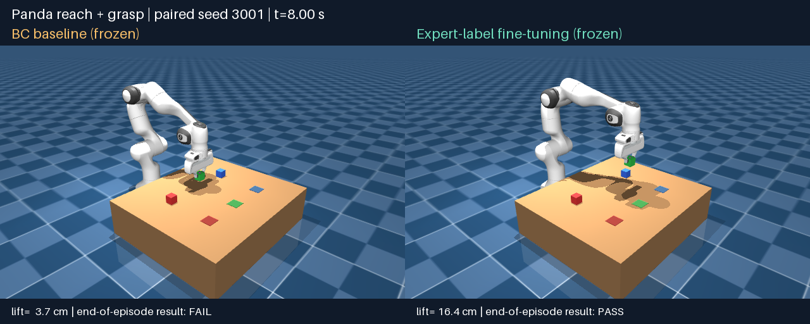

# Panda 机械臂：CPU行为克隆与专家补标微调

第一阶段发布，2026-10-25。受算力与时间限制，目前以小型状态策略完成接近、抓取、抬升和保持；后续继续扩展移动、放置与更广泛评估，详见[阶段计划](../docs/phase-one.md)。

基于 MuJoCo 和 PyTorch，从规则专家采集数据，训练 Panda 完成水平接近、下降、闭合、抬升和保持，再针对模型自己遇到的闭合后状态补充专家标签。

学习策略使用**仿真状态输入**，输出 XYZ 小位移与夹爪开合。固定向下的朝向和 IK 由控制器执行；任务从固定悬停位置开始，以抓起并稳定保持结束。

## 已验证结果：2026-10-24

在相同的20个新随机位置（种子3000–3019）上进行配对测试：

| 指标 | 原BC | 专家补标微调后 |
|---|---:|---:|
| 成功次数 | 14/20（70%） | 20/20（100%） |
| 抬升后水平位移中位数 | 161.50毫米 | 1.78毫米 |
| 原模型成功、新模型失败的回合 | — | 0 |

两模型的初始物理状态完全一致，测试期间权重冻结。成功要求最后0.5秒持续抬高至少10厘米，位移不超过1厘米，方块与抓取点距离不超过4厘米。水平位移指标另外统计首次抬高10厘米后到结束的最大横向位移，不改变成功判据。

这些数字仅对应本任务范围和20对测试。[逐回合证据与模型哈希](experiments/2026-10-24/paired_results.json)；[实验说明](docs/experiment-results.md)。

[观看同步对比视频](robotic-arm-pick-and-place/media/learning_comparison.mp4)



视频选取评估中的种子3001作示例；总体结果仍使用全部20个位置。视频是保存动作的同步回放，逐步观测误差核对为0。

## 快速运行冻结模型（Windows PowerShell）

以下命令从本仓库根目录执行。实测 Python 3.13.0、PyTorch 2.10.0+cpu、NumPy 2.2.6、MuJoCo 3.16.0。策略训练和推理使用CPU；窗口与视频使用OpenGL图形驱动，不要求CUDA。

```powershell
py -3.13 -m venv .venv-bc
& '.\.venv-bc\Scripts\python.exe' -m pip install -r '.\robotic-arm-pick-and-place\requirements-bc-cpu.txt'
& '.\.venv-bc\Scripts\python.exe' -X utf8 -B '.\robotic-arm-pick-and-place\show_frozen_policy.py' --model aggregated --seed 3001 --viewer
```

冻结权重随仓库保存在 experiments/2026-10-24/checkpoints/，不需要本机原始训练数据。将 model 改为 bc 可在同一种子上观察原BC模型。冻结包保留源模型哈希，导出前后参数逐项相等；不含本机绝对路径。

## 从数据采集开始复现

```powershell
.\reproduce_learning.ps1 -VerifyOnly
.\reproduce_learning.ps1 -Smoke
.\reproduce_learning.ps1
```

短验检查各步骤能否衔接，不代表正式性能。正式流程采集40条专家轨迹、训练BC、采集40条策略状态的专家标签、微调，再做20对新位置评估。它产生新的时间戳目录，保留成功和失败记录。

已有解释器可通过 -Python 指定完整路径。详见[复现与排错指南](docs/reproduction.md)。

## 项目资料

- [工作原理与状态/动作接口](docs/architecture.md)
- [实验设置、结果和证据边界](docs/experiment-results.md)
- [第一阶段状态与后续计划](../docs/phase-one.md)
- [上游原始README留存](docs/upstream-readme.md)

本项目在 [RafayDon/Mujoco-Robotic-Arm-Pick-and-Place](https://github.com/RafayDon/Mujoco-Robotic-Arm-Pick-and-Place) 的规则控制系统上增加学习流程。上游README中12回合100%的规则控制结果属于上游，不能作为本学习项目的个人实验结果。

上游代码的MIT声明见留存README；Panda模型来自 [MuJoCo Menagerie](https://github.com/google-deepmind/mujoco_menagerie)，保留原 [Apache-2.0资产许可](robotic-arm-pick-and-place/assets/franka_emika_panda/LICENSE)。原始GIF与成功率图片为上游示例，学习对比视频由本次实测动作生成。
