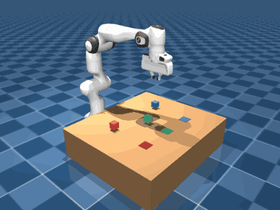
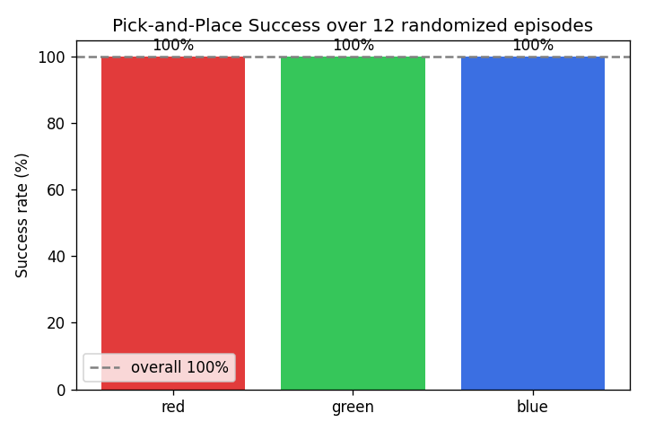

# 上游规则控制项目README留存

本页保留扩展前的项目说明。原文中的12回合100%属于上游规则控制结果，不属于本次学习扩展的个人实验。运行学习流程请使用[主README](../README.md)。

---

# Robotic Arm Pick-and-Place System (MuJoCo)

A 7-DOF Franka Emika Panda arm picks up colored cubes from a table and places
them on matching target pads — simulated with realistic physics in
[MuJoCo](https://mujoco.org). The arm is driven by **inverse kinematics** and a
rule-based pick-and-place routine, with automatic success detection and
quantitative evaluation over randomized episodes.

Runs entirely on **CPU** — no GPU required.



## Highlights

- Realistic 7-joint arm + 2-finger gripper (Google DeepMind's MuJoCo Menagerie model)
- Inverse kinematics via the MuJoCo Jacobian (damped least squares) — generalizes to any reachable position
- Smooth, controlled joint motion (ramped position targets, no snapping)
- Full pick → lift → place → release routine with grasp held under physics
- Automatic success detection (cube within 5 cm of its target pad)
- Object randomization + evaluation that reports per-color and overall success rates
- Offscreen rendering to GIF/MP4 — no display needed

## Results

Evaluated over 12 episodes with cubes randomized across the reachable workspace:



| Cube  | Success rate |
|-------|--------------|
| Red   | 100%         |
| Green | 100%         |
| Blue  | 100%         |
| **Overall** | **100%** |

## Project structure

```
robotic-arm-pick-and-place/
├── README.md
├── requirements.txt
├── assets/
│   └── franka_emika_panda/      # Menagerie Panda model + our scene.xml
│       ├── panda.xml            # arm model (with an added grasp_site)
│       └── scene.xml            # arm + table + 3 cubes + 3 target pads + camera
├── controllers/
│   └── scripted_controller.py   # IK + pick-and-place routine + success check
├── scripts/
│   ├── move_arm.py              # Phase 2: smooth motion demo
│   ├── run_pick_place.py        # live viewer demo of the full task
│   └── record_demo.py           # render the task to media/demo.gif
├── eval/
│   └── evaluate.py              # randomized episodes + success-rate chart
├── utils/
│   └── recording.py             # offscreen GIF/MP4 recorder
└── media/                       # demo.gif, success_rates.png
```

## Setup (macOS)

Use Python 3.11 or 3.12.

```bash
python3 -m venv venv
source venv/bin/activate
pip install --upgrade pip
pip install -r requirements.txt
```

The Franka model is included. (It originates from
[MuJoCo Menagerie](https://github.com/google-deepmind/mujoco_menagerie),
Apache-2.0; the project adds a single `grasp_site` to `panda.xml` and a custom
`scene.xml`.)

## Running

**Live 3D viewer (full task).** On macOS the interactive viewer must be launched
with `mjpython` (it ships with the `mujoco` package):

```bash
mjpython scripts/run_pick_place.py
```

**Record a demo GIF** (renders offscreen, so plain `python` is fine):

```bash
python scripts/record_demo.py
# headless server: prefix with MUJOCO_GL=osmesa
```

**Evaluate** over randomized episodes and produce the chart:

```bash
python eval/evaluate.py --episodes 20
```

## How it works

1. **Scene** — `scene.xml` includes the Panda and adds a table, three
   free-floating cubes, and three massless target sites.
2. **Inverse kinematics** — given a desired gripper position (and a downward
   orientation), `ik()` iterates `dq = Jᵀ(JJᵀ + λ²I)⁻¹·error` using the
   site Jacobian until the gripper reaches the target. It runs on a scratch
   copy of the state, so it never disturbs the live simulation.
3. **Motion** — solved joint angles become smooth position-servo targets,
   ramped gradually so motion looks natural.
4. **Pick-and-place** — hover, descend, close gripper, lift, travel, lower,
   release, retreat. Grasping relies on contact friction between the fingertip
   pads and the cube.
5. **Success** — a placement counts if the cube ends within 5 cm of its target
   pad and stays on the table.

## Limitations & future work

- Grasps are top-down on cube-shaped objects within the arm's reachable region.
- The controller is rule-based (not learned). A natural extension is to wrap the
  scene as a Gymnasium environment and train a policy with PPO — left as future
  work since reliable on-CPU training requires significant reward shaping and time.

## License

Project code: MIT. The Franka Panda model is from MuJoCo Menagerie (Apache-2.0);
see `assets/franka_emika_panda/LICENSE`.
